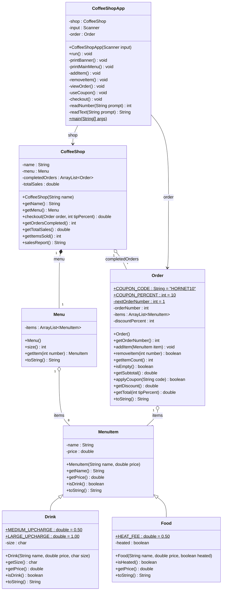

# Hornet Coffee: the class diagram

This is the plan for your whole project. Build **exactly** these classes, with **exactly**
these names. The check tests look for these names. If you name a method `getCost` instead of
`getPrice`, the test can not find it, and the test turns red.

## How to read the diagram

Each box is one class. The box has three parts:

| Part of the box | What it holds | Example |
|---|---|---|
| Top | The class name | `MenuItem` |
| Middle | The **fields** (the data each object keeps) | `-name : String` |
| Bottom | The **methods** (what the object can do) | `+getPrice() double` |

| Symbol | Meaning |
|---|---|
| `-` | **private**. Only code inside this class can use it. Every field is private. |
| `+` | **public**. Any class can use it. |
| underlined, or `$` at the end | **static**. It belongs to the class, not to one object. |
| `+getPrice() double` | A method named `getPrice`. It takes nothing and gives back a `double`. |
| `MenuItem <|-- Drink` (arrow with an empty triangle) | **Inheritance.** `Drink extends MenuItem`. A Drink **is a** MenuItem. |
| arrow with a diamond | **Has a.** One object keeps other objects in a field. `Order` has `MenuItem`s. |
| `1`, `8`, `*` | **How many.** `*` means "any number". |

## The whole system



> **Can't see the picture?** GitHub draws it for you. Open this file on GitHub. In IntelliJ,
> click the preview button at the top right of the file. If you still see only text, the
> tables below say the same thing.

---

## Every class, one at a time

All seven classes go in **one package** named `coffeeshop`. Every money amount is a
`double`. Every price is shown with 2 decimals: `String.format("%.2f", price)` turns `3.5`
into `"3.50"`.

### Step 1 · `MenuItem`

One thing you can buy. `Drink` and `Food` are built on top of it.

| Member | What it does | Example |
|---|---|---|
| `-name : String`, `-price : double` | The item's name and its price. | `"Bagel"`, `2.75` |
| `+MenuItem(String name, double price)` | Saves both into the fields. | `new MenuItem("Bagel", 2.75)` |
| `+getName() String` | Gives back the name. | `"Bagel"` |
| `+getPrice() double` | Gives back the price. | `2.75` |
| `+isDrink() boolean` | Always gives back `false`. `Drink` changes this. | `false` |
| `+toString() String` | The name, `" - $"`, then the price with 2 decimals. Use `getPrice()`, not `price`. | `"Bagel - $2.75"` |

### Step 2 · `Drink extends MenuItem`

A drink has a size: `'S'`, `'M'` or `'L'`. Bigger sizes cost more.

| Member | What it does | Example |
|---|---|---|
| `+MEDIUM_UPCHARGE`, `+LARGE_UPCHARGE` | `public static final double` constants: `0.50` and `1.00`. | |
| `-size : char` | Always `'S'`, `'M'` or `'L'`. | |
| `+Drink(String name, double price, char size)` | Calls `super(name, price)`. Turns the size into a capital (`Character.toUpperCase`). Anything that is not `M` or `L` becomes `'S'`. | `new Drink("Latte", 3.25, 'm')` has size `'M'` |
| `+getSize() char` | Gives back the size. | `'M'` |
| `+getPrice() double` | **Override.** `super.getPrice()` plus the upcharge for the size. | Latte M: `3.25 + 0.50` = `3.75` |
| `+isDrink() boolean` | **Override.** Gives back `true`. | `true` |
| `+toString() String` | **Override.** Name, size in `( )`, then price. | `"Latte (M) - $3.75"` |

### Step 2 · `Food extends MenuItem`

Food can be heated up for 50 cents.

| Member | What it does | Example |
|---|---|---|
| `+HEAT_FEE` | `public static final double` constant: `0.50`. | |
| `-heated : boolean` | `true` if the customer wants it warm. | |
| `+Food(String name, double price, boolean heated)` | Calls `super(name, price)`, then saves `heated`. | `new Food("Bagel", 2.75, true)` |
| `+isHeated() boolean` | Gives back `heated`. | `true` |
| `+getPrice() double` | **Override.** Adds `HEAT_FEE` when heated. | heated Bagel: `3.25` |
| `+toString() String` | **Override.** When heated: `"Bagel, heated - $3.25"`. When not heated: `return super.toString();` | `"Bagel - $2.75"` |

### Step 3 · `Menu`

Everything the shop sells, in this order. Drinks go in as size `'S'`. Food goes in not heated.

| # | Item | Class | Price (small) |
|---|---|---|---|
| 1 | Coffee | `Drink` | 2.00 |
| 2 | Latte | `Drink` | 3.25 |
| 3 | Cappuccino | `Drink` | 3.25 |
| 4 | Hot Chocolate | `Drink` | 2.50 |
| 5 | Iced Tea | `Drink` | 2.25 |
| 6 | Bagel | `Food` | 2.75 |
| 7 | Blueberry Muffin | `Food` | 2.50 |
| 8 | Breakfast Sandwich | `Food` | 4.50 |

| Member | What it does | Example |
|---|---|---|
| `-items : ArrayList<MenuItem>` | The 8 items. One list holds both Drinks and Food, because both **are** MenuItems. | |
| `+Menu()` | Makes the list and adds the 8 items from the table. | |
| `+size() int` | How many items. | `8` |
| `+getItem(int number) MenuItem` | `number` starts at **1**, the way a customer counts. Item 1 is at index 0. A number that is not on the menu gives back `null`. | `getItem(1)` is Coffee. `getItem(9)` is `null`. |
| `+toString() String` | One line per item: the number, `". "`, then the item. Each line ends with `"\n"`. | `"1. Coffee (S) - $2.00\n2. Latte (S) - $3.25\n..."` |

### Step 4 · `Order`

One customer's order.

| Member | What it does | Example |
|---|---|---|
| `+COUPON_CODE`, `+COUPON_PERCENT` | `public static final` constants: `"HORNET10"` and `10`. | |
| `-nextOrderNumber : int` | **static**, starts at `1`. One number shared by every Order. | |
| `-orderNumber`, `-items`, `-discountPercent` | This order's number, its items, and its discount (starts at `0`). | |
| `+Order()` | Takes `nextOrderNumber` as this order's number, then adds 1 to `nextOrderNumber`. Makes an empty list. | The first order is #1, the next is #2. |
| `+getOrderNumber() int` | Gives back this order's number. | `1` |
| `+addItem(MenuItem item) void` | Adds the item to the list. | |
| `+removeItem(int number) boolean` | `number` starts at **1**. Removes that item and gives back `true`. If there is no such item, removes nothing and gives back `false`. | |
| `+getItemCount() int`, `+isEmpty() boolean` | How many items, and whether there are none. | |
| `+getSubtotal() double` | Adds up `getPrice()` of every item. Each item uses **its own** `getPrice()`, so a large drink costs more. | Latte M + heated Bagel = `7.00` |
| `+applyCoupon(String code) boolean` | If `code` (with spaces trimmed, any capitals) equals `COUPON_CODE`, set `discountPercent` to `COUPON_PERCENT` and give back `true`. Otherwise give back `false`. | `" hornet10 "` works |
| `+getDiscount() double` | `subtotal × discountPercent / 100.0` | `0.70` |
| `+getTotal(int tipPercent) double` | First take off the discount. Then add a tip of `tipPercent` % of **what is left**. A tip below 0 counts as 0. | `7.00 − 0.70 = 6.30`, plus 20% (`1.26`) = `7.56` |
| `+toString() String` | `"Order #1"` on the first line. Then each item on its own line, numbered from 1. Then `"Subtotal: $7.00"`. If there is a discount, a `"Discount: -$0.70"` line too. | see below |

```
Order #1
  1. Latte (M) - $3.75
  2. Bagel, heated - $3.25
  Subtotal: $7.00
```

> **Why is there no tax?** Delaware has no sales tax. Our shop is in Dover.

### Step 5 · `CoffeeShop`

The shop. It keeps its menu and every finished order.

| Member | What it does | Example |
|---|---|---|
| `+CoffeeShop(String name)` | Saves the name, makes a `new Menu()`, makes an empty list of orders, and sets sales to `0`. | `new CoffeeShop("Hornet Coffee")` |
| `+getName() String`, `+getMenu() Menu` | Give back the name and the menu. | |
| `+checkout(Order order, int tipPercent) double` | If the order is empty, give back `0` and save nothing. Otherwise find the total, add the order to `completedOrders`, add the total to `totalSales`, and give back the total. | `8.40` |
| `+getOrdersCompleted() int` | How many orders are finished. | `2` |
| `+getTotalSales() double` | All the money taken in today. | `15.40` |
| `+getItemsSold() int` | Adds up `getItemCount()` of every finished order. | `4` |
| `+salesReport() String` | Four lines, like the box below. | |

```
Hornet Coffee - today's sales
  Orders: 1
  Items sold: 2
  Total: $8.40
```

### Step 6 · `CoffeeShopApp`: the game loop

This is the program the customer plays. The README (Step 6) shows the screens and the exact
sentences the test looks for.

| Member | What it does |
|---|---|
| `-shop`, `-input`, `-order` | The shop, the keyboard reader, and the order being built right now. |
| `+CoffeeShopApp(Scanner input)` | Saves `input`. Makes `new CoffeeShop("Hornet Coffee")` and a `new Order()`. |
| `+run() void` | **The game loop.** Prints the banner once. Then, again and again: print the main menu, read a number, do that choice. It stops **only** when the user picks `0`. Then it prints `Shop closed. Goodbye!` |
| `-printBanner()`, `-printMainMenu()` | Print the art and the menu screen. |
| `-addItem()`, `-removeItem()`, `-viewOrder()`, `-useCoupon()`, `-checkout()` | One method for each menu choice. `checkout()` starts a `new Order()` when it is done. |
| `-readNumber(String prompt) int`, `-readText(String prompt) String` | **Given code.** Copy them from the README. |
| `+main(String[] args)` | **static.** Makes `new CoffeeShopApp(new Scanner(System.in))` and calls `run()`. |
